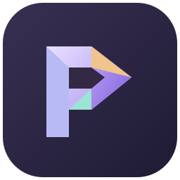

# Prisma

**[Abrir Prisma](https://oscard0823.github.io/prisma/)**

Tu espacio de trabajo local: documentos, hojas, presentaciones, PDF, datos y publicaciones. Aplicación web instalable que trabaja con documentos en el dispositivo. Autor: [OscarD0823](https://github.com/OscarD0823).

Esta página es una publicación independiente de Prisma, con su propio manifiesto, recursos y caché de aplicación. Prisma reúne los seis editores y la biblioteca local.

[Descargar Windows y Android](https://github.com/OscarD0823/prisma-pdf/releases/tag/prisma-v1.1.0) · [Código compartido y licencia](https://github.com/OscarD0823/prisma-pdf) · [Página de proyectos](https://oscard0823.github.io/Pagina-Principal/)

## Publicación

El flujo `pages.yml` compila este producto desde el código público de `OscarD0823/prisma-pdf`, rama `main`, y lo publica en este repositorio con GitHub Pages. Para actualizarlo, ejecuta ese flujo desde Actions. La compilación incluye el código fuente correspondiente descargable desde la aplicación. No hay documentos de usuarios en el repositorio ni en la publicación.

Las funciones de Office y los formatos admitidos tienen los límites documentados en el repositorio compartido. Los proyectos locales no se sincronizan automáticamente entre dispositivos.
